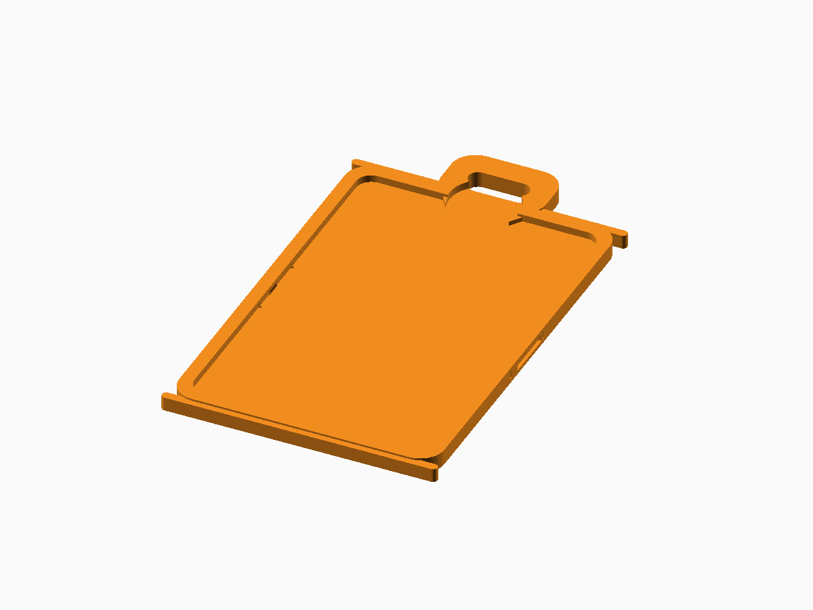
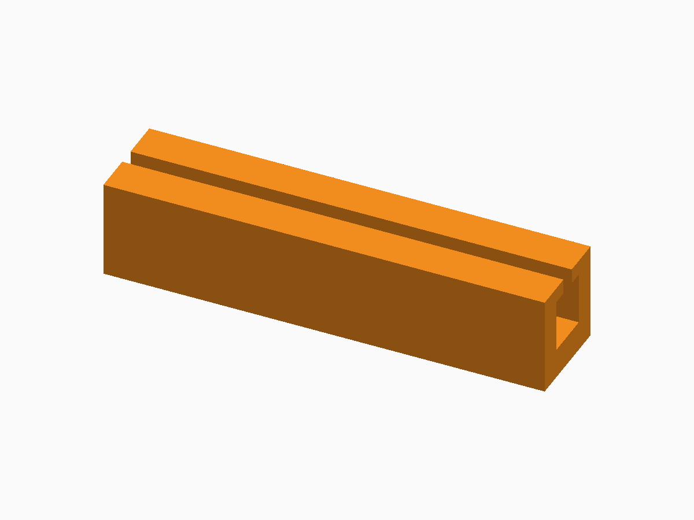
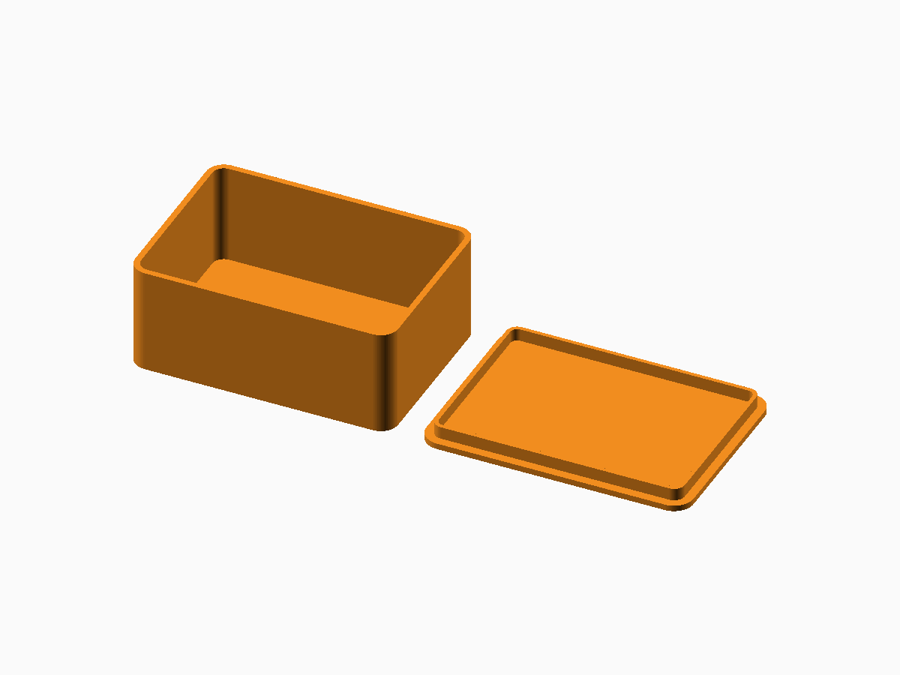
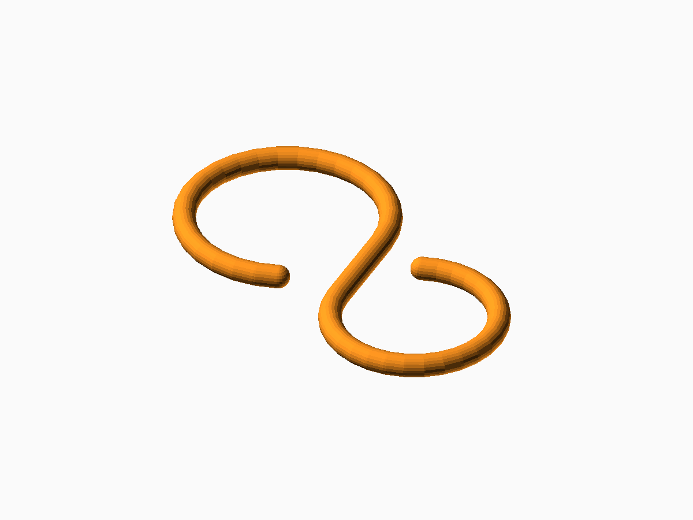
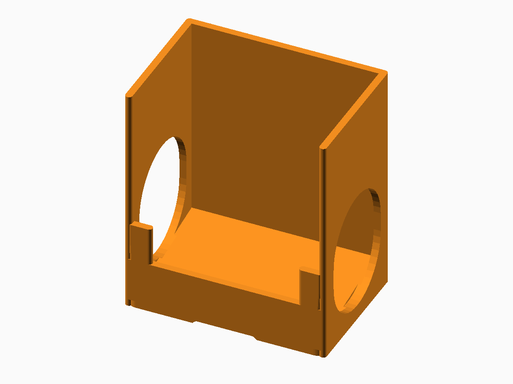

# OpenSCAD Generators

A curated public collection of editable parametric OpenSCAD generators, ready-to-slice STL examples, and matching digital renders.

> The images in this repository are digital OpenSCAD renders. They are not photographs of physical prints. Each project README states its validation and physical-test status.

## Generator gallery

<table>
  <tr>
    <td align="center"><a href="cr80-card-holder/README.md"> <strong>CR80 / ID-1 Card Holder</strong></a></td>
    <td align="center"><a href="cable-clips/README.md"> <strong>Adjustable Cable Clips</strong></a></td>
    <td align="center"><a href="decorative-insects/README.md"> <strong>Decorative Insects</strong></a></td>
  </tr>
  <tr>
    <td align="center"><a href="parametric-box/README.md"> <strong>Parametric Box</strong></a></td>
    <td align="center"><a href="parametric-keyring/README.md"> <strong>Parametric Keyring</strong></a></td>
    <td align="center"><a href="s-hook/README.md"> <strong>Parametric S-Hook</strong></a></td>
  </tr>
  <tr>
    <td align="center"><a href="storage-system/README.md"> <strong>Parametric Storage System</strong></a></td>
    <td align="center"><a href="tea-bag-dispenser/README.md"> <strong>Tea-Bag Dispenser</strong></a></td>
    <td align="center"><a href="text-generator/README.md"> <strong>3D Text Generator</strong></a></td>
  </tr>
  <tr>
    <td align="center"><a href="universal-clock-dial/README.md"> <strong>Universal Clock Dial</strong></a></td>
    <td align="center"><a href="universal-sign/README.md"> <strong>Universal Sign Generator</strong></a></td>
    <td align="center"><a href="usb-stick-holder/README.md"> <strong>USB Stick Holder</strong></a></td>
  </tr>
</table>

## Install OpenSCAD Nightly

These generators target a recent **OpenSCAD development snapshot / Nightly**. Download the appropriate snapshot from the official [OpenSCAD downloads page](https://openscad.org/downloads.html#snapshots).

Some text-based generators use the experimental `textmetrics` feature. Enable it in **Edit → Preferences → Features → textmetrics**, then restart or reopen the model if required.

## Use a generator

1. Clone or download this repository.
2. Open the generator `.scad` file in OpenSCAD Nightly.
3. Open **Window → Customizer**, change the parameters, and preview with **F5**.
4. Press **F6** for the final render and export STL from the **File** menu.
5. Slice the STL with a profile for your printer and material. Calibrate fit-sensitive parts before a full print.

Each project folder also contains curated STL examples under `stl-files/` and matching digital renders under `images/`.

## Validation and provenance

The public tree is generated from an explicit whitelist in the private canonical source repository. Every published SCAD file is rendered in isolation; every STL is checked for closed topology and bed bounds and is smoke-sliced with PrusaSlicer.

Generated from canonical source commit `481b1feae297b11311978708135ffef607aba5b6` using OpenSCAD Nightly. Public assets are updated in place rather than manually edited here.

## License

All SCAD sources, STL models, renders, and documentation in this repository are licensed under [Creative Commons Attribution-NonCommercial 4.0 International](LICENSE.md).
