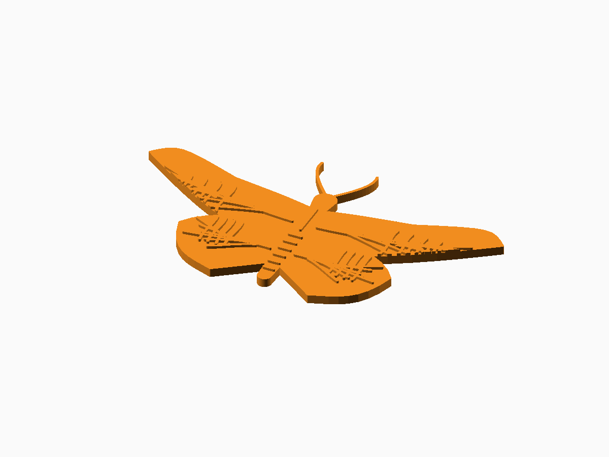

# Decorative Insects

**Status:** Digitally validated for representative 3D output.

The editable generator is [decorative-insects.scad](decorative-insects.scad). FDM reliefs and flat models; the generator also supports laser, vinyl, and engraving output.

## Defaults and important controls

Free-form butterfly relief at approximately 100 mm wingspan and 52 mm body length.

**Fit and tolerance:** Adapt Min_Feature to the nozzle, kerf, or cutting tool.

Open the SCAD file in OpenSCAD and use **Window → Customizer** to change the documented parameters. Dimensions are millimetres.

## OpenSCAD and export

This generator is maintained and validated with a recent OpenSCAD Nightly build.

1. Open the SCAD file and select parameters in Customizer.
2. Press **F6** for a full render.
3. Use **File → Export → Export as STL** for printable 3D output.
4. Slice with the actual printer, nozzle, material, and layer profile.

## Included examples

| Preset | STL | Digital render |
| --- | --- | --- |
| Default butterfly relief | [Download](stl-files/butterfly-relief.stl) | [Preview](images/butterfly-relief.png) |
| Flat emperor dragonfly | [Download](stl-files/dragonfly-flat.stl) | [Preview](images/dragonfly-flat.png) |

## Printing and fabrication

Print flat or relief models with the broad rear face on the bed.

The included STL files passed digital mesh and slicer checks. Digital validation does not establish physical fit, strength, fatigue life, or material suitability.

## Known limitations

- Fine veins and stencil bridges require process-specific testing.
- The included public package contains STL examples only.

## License

The SCAD source, STL models, renders, and documentation in this public package are licensed under **CC BY-NC 4.0**. See the repository [LICENSE](../LICENSE.md).
