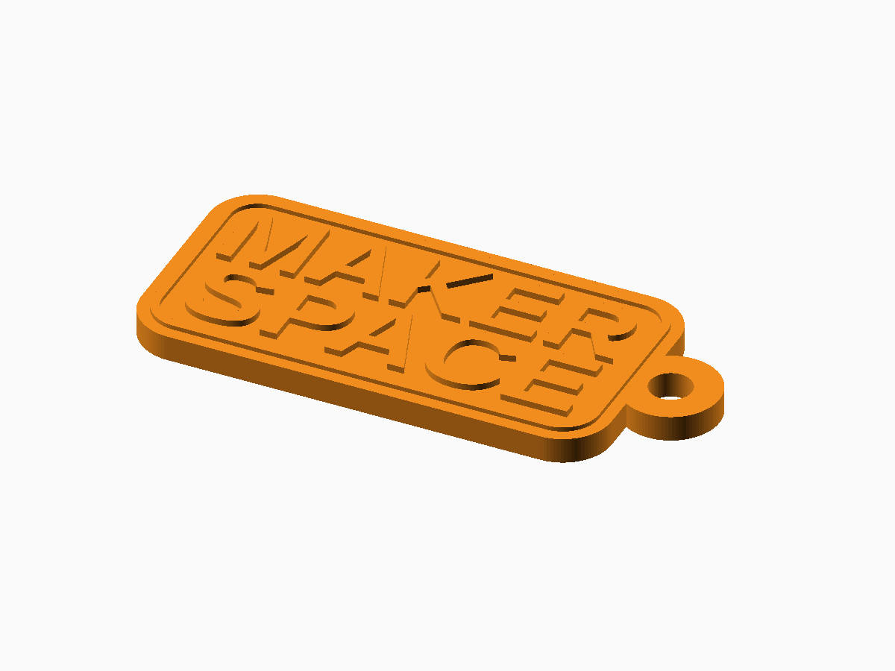

# Parametric Keyring

**Status:** Digitally validated; lug strength and inlay fit require physical tests.

The editable generator is [parametric-keyring.scad](parametric-keyring.scad). FDM printing; the generator also provides intentional 2D output.

## Defaults and important controls

58 × 30 × 3.2 mm rounded rectangle, reinforced right lug, and two-line raised text.

**Fit and tolerance:** The default inlay clearance is 0.12 mm and must be calibrated per printer.

Open the SCAD file in OpenSCAD and use **Window → Customizer** to change the documented parameters. Dimensions are millimetres.

## OpenSCAD and export

This generator requires a recent OpenSCAD Nightly build with `textmetrics` enabled.

1. Open the SCAD file and select parameters in Customizer.
2. Press **F6** for a full render.
3. Use **File → Export → Export as STL** for printable 3D output.
4. Slice with the actual printer, nozzle, material, and layer profile.

## Included examples

| Preset | STL | Digital render |
| --- | --- | --- |
| Default raised text | [Download](stl-files/raised-text.stl) | [Preview](images/raised-text.png) |
| Heart with two lugs | [Download](stl-files/heart-two-lugs.stl) | [Preview](images/heart-two-lugs.png) |
| Separate inlay text insert | [Download](stl-files/inlay-insert.stl) | [Preview](images/inlay-insert.png) |

## Printing and fabrication

Print 3D keyrings flat on the bed.

The included STL files passed digital mesh and slicer checks. Digital validation does not establish physical fit, strength, fatigue life, or material suitability.

## Known limitations

- Requires OpenSCAD Nightly with textmetrics enabled.
- Small text and ring holes need visual and physical inspection.

## License

The SCAD source, STL models, renders, and documentation in this public package are licensed under **CC BY-NC 4.0**. See the repository [LICENSE](../LICENSE.md).
