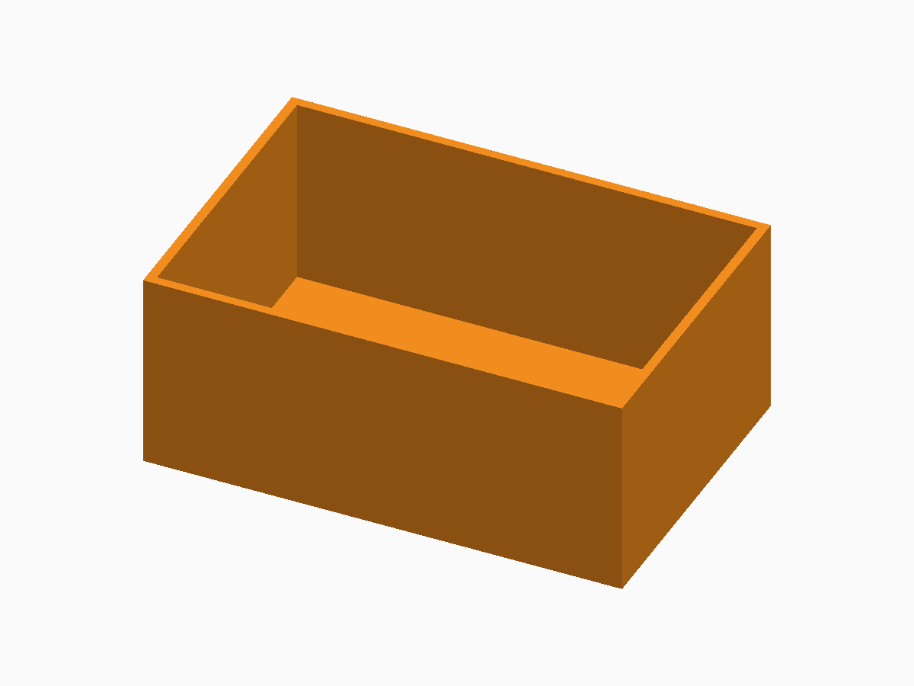

# Parametric Storage System

**Status:** Digital release candidate; representative physical fit test and photos are still required.

The editable generator is [storage-system.scad](storage-system.scad). FDM printing in PLA or PETG with a common 0.4 mm nozzle.

## Defaults and important controls

120 × 80 × 50 mm outside dimensions with box, cap lid, and removable two-compartment divider.

**Fit and tolerance:** fit_clearance is per side and defaults to 0.35 mm. Calibrate before a complete set.

Open the SCAD file in OpenSCAD and use **Window → Customizer** to change the documented parameters. Dimensions are millimetres.

## OpenSCAD and export

This generator is maintained and validated with a recent OpenSCAD Nightly build.

1. Open the SCAD file and select parameters in Customizer.
2. Press **F6** for a full render.
3. Use **File → Export → Export as STL** for printable 3D output.
4. Slice with the actual printer, nozzle, material, and layer profile.

## Included examples

| Preset | STL | Digital render |
| --- | --- | --- |
| Standard box | [Download](stl-files/standard-box.stl) | [Preview](images/standard-box.png) |
| Standard cap lid | [Download](stl-files/standard-lid.stl) | [Preview](images/standard-lid.png) |
| Standard two-compartment divider | [Download](stl-files/standard-divider.stl) | [Preview](images/standard-divider.png) |

## Printing and fabrication

Print the box and divider upright; print the lid with its top face on the bed.

The included STL files passed digital mesh and slicer checks. Digital validation does not establish physical fit, strength, fatigue life, or material suitability.

## Known limitations

- Digital validation does not prove lid or divider fit.
- The public single-file bundle contains the v1 box, lid, and divider only.

## License

The SCAD source, STL models, renders, and documentation in this public package are licensed under **CC BY-NC 4.0**. See the repository [LICENSE](../LICENSE.md).
