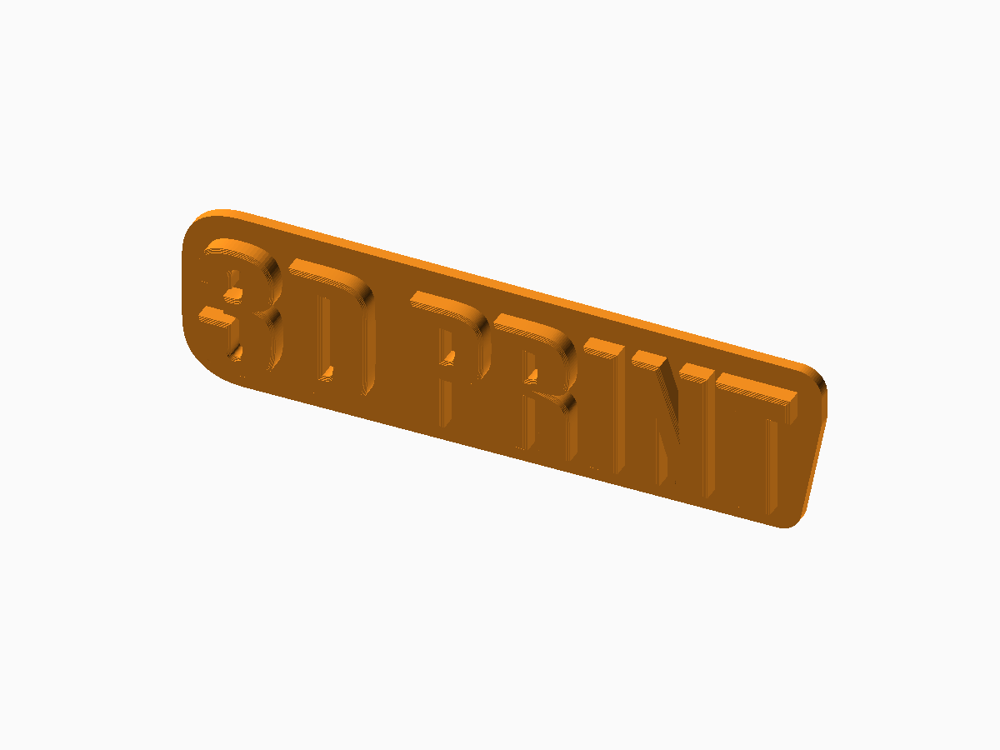

# 3D Text Generator

**Status:** Digitally validated with current OpenSCAD Nightly.

The editable generator is [text-generator.scad](text-generator.scad). FDM printing for free-standing text, plaques, and plinth signs.

## Defaults and important controls

3D PRINT in Impact Regular at 30 mm, 5 mm deep, on an auto-sized convex base.

**Fit and tolerance:** Font availability changes measured geometry; inspect the resolved-font diagnostics.

Open the SCAD file in OpenSCAD and use **Window → Customizer** to change the documented parameters. Dimensions are millimetres.

## OpenSCAD and export

This generator requires a recent OpenSCAD Nightly build with `textmetrics` enabled.

1. Open the SCAD file and select parameters in Customizer.
2. Press **F6** for a full render.
3. Use **File → Export → Export as STL** for printable 3D output.
4. Slice with the actual printer, nozzle, material, and layer profile.

## Included examples

| Preset | STL | Digital render |
| --- | --- | --- |
| Default standing text | [Download](stl-files/standing-text.stl) | [Preview](images/standing-text.png) |
| Engraved plaque | [Download](stl-files/engraved-plaque.stl) | [Preview](images/engraved-plaque.png) |
| Multiline plinth | [Download](stl-files/multiline-stand.stl) | [Preview](images/multiline-stand.png) |

## Printing and fabrication

Print plaques and plinths on a broad flat surface; inspect standing exports before slicing.

The included STL files passed digital mesh and slicer checks. Digital validation does not establish physical fit, strength, fatigue life, or material suitability.

## Known limitations

- Requires OpenSCAD Nightly with textmetrics enabled.
- Very small text, missing fonts, and shallow engraving need visual review.

## License

The SCAD source, STL models, renders, and documentation in this public package are licensed under **CC BY-NC 4.0**. See the repository [LICENSE](../LICENSE.md).
