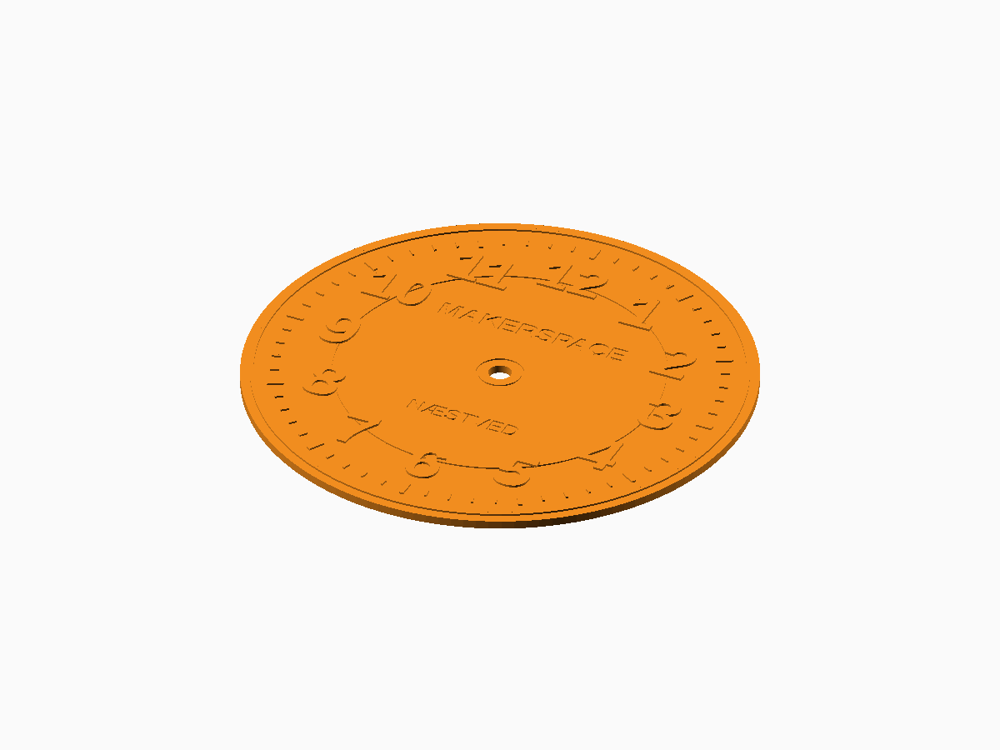

# Universal Clock Dial

**Status:** Digitally validated; movement fit and hand clearance require physical checks.

The editable generator is [universal-clock-dial.scad](universal-clock-dial.scad). FDM printing plus optional laser, CNC, vinyl, or plotter workflows.

## Defaults and important controls

180 mm round, 3 mm thick dial with 8.2 mm centre hole, rings, track, numbers, and text.

**Fit and tolerance:** Measure the clock movement shaft, recess, and hand stack before manufacturing.

Open the SCAD file in OpenSCAD and use **Window → Customizer** to change the documented parameters. Dimensions are millimetres.

## OpenSCAD and export

This generator requires a recent OpenSCAD Nightly build with `textmetrics` enabled.

1. Open the SCAD file and select parameters in Customizer.
2. Press **F6** for a full render.
3. Use **File → Export → Export as STL** for printable 3D output.
4. Slice with the actual printer, nozzle, material, and layer profile.

## Included examples

| Preset | STL | Digital render |
| --- | --- | --- |
| Default round dial | [Download](stl-files/round.stl) | [Preview](images/round.png) |
| Star dial with subdial | [Download](stl-files/star-subdial.stl) | [Preview](images/star-subdial.png) |

## Printing and fabrication

Print the dial flat on its rear face.

The included STL files passed digital mesh and slicer checks. Digital validation does not establish physical fit, strength, fatigue life, or material suitability.

## Known limitations

- Requires OpenSCAD Nightly with textmetrics enabled.
- Fine marks and text must match the nozzle or tool resolution.

## License

The SCAD source, STL models, renders, and documentation in this public package are licensed under **CC BY-NC 4.0**. See the repository [LICENSE](../LICENSE.md).
