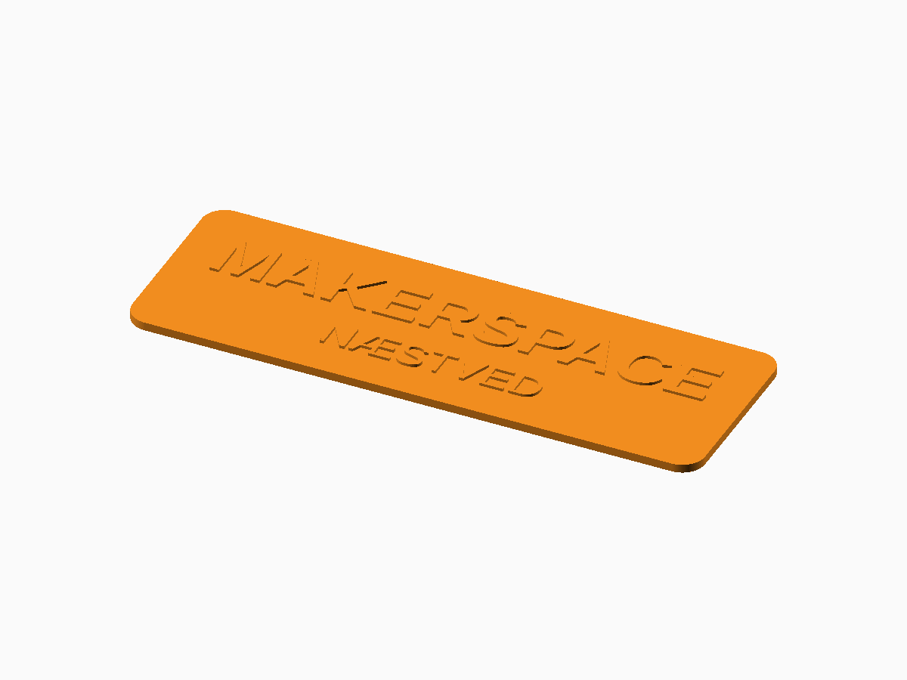

# Universal Sign Generator

**Status:** Digitally validated for representative 3D constructions.

The editable generator is [universal-sign.scad](universal-sign.scad). FDM printing plus optional CNC, laser cutting, and engraving output.

## Defaults and important controls

Auto-sized rounded rectangular 3 mm plate with raised text and straight edges.

**Fit and tolerance:** Verify installed fonts and calibrate inlay, fold, kerf, and mounting dimensions.

Open the SCAD file in OpenSCAD and use **Window → Customizer** to change the documented parameters. Dimensions are millimetres.

## OpenSCAD and export

This generator requires a recent OpenSCAD Nightly build with `textmetrics` enabled.

1. Open the SCAD file and select parameters in Customizer.
2. Press **F6** for a full render.
3. Use **File → Export → Export as STL** for printable 3D output.
4. Slice with the actual printer, nozzle, material, and layer profile.

## Included examples

| Preset | STL | Digital render |
| --- | --- | --- |
| Default flat plate | [Download](stl-files/flat-plate.stl) | [Preview](images/flat-plate.png) |
| Desk L-stand | [Download](stl-files/desk-stand.stl) | [Preview](images/desk-stand.png) |
| Separate inlay text insert | [Download](stl-files/inlay-insert.stl) | [Preview](images/inlay-insert.png) |

## Printing and fabrication

Print flat plates face-up or face-down as appropriate; inspect supports for desk assemblies.

The included STL files passed digital mesh and slicer checks. Digital validation does not establish physical fit, strength, fatigue life, or material suitability.

## Known limitations

- Accurate sizing requires OpenSCAD Nightly with textmetrics enabled.
- Desk joinery and inlays require physical calibration.

## License

The SCAD source, STL models, renders, and documentation in this public package are licensed under **CC BY-NC 4.0**. See the repository [LICENSE](../LICENSE.md).
