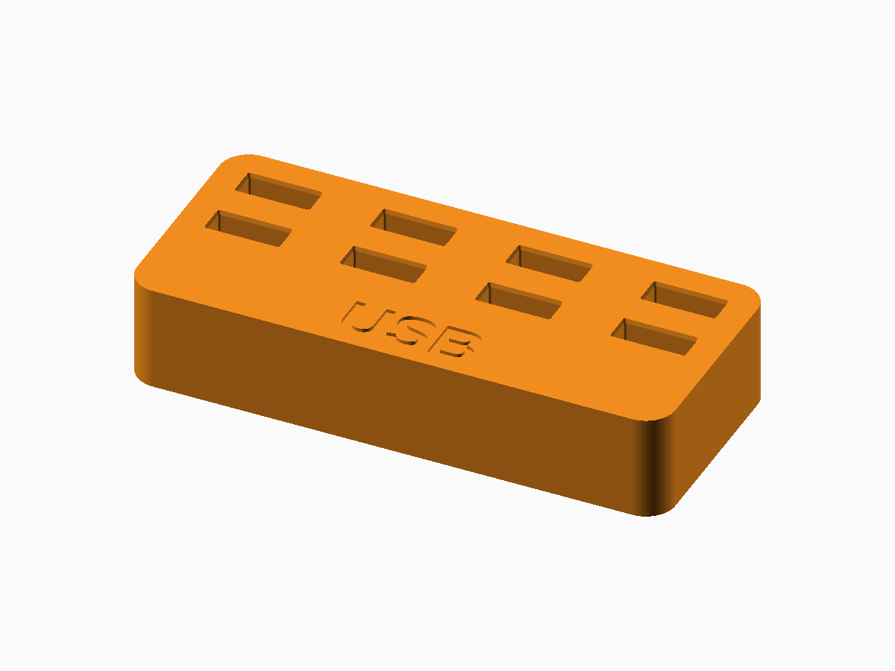

# USB Stick Holder

**Status:** Digitally validated; connector retention requires physical calibration.

The editable generator is [usb-stick-holder.scad](usb-stick-holder.scad). FDM printing in PLA or PETG.

## Defaults and important controls

Eight-position rectangular holder, 18 mm high, for nominal 12.0 × 4.5 mm USB-A plugs.

**Fit and tolerance:** Print the clearance test before a large holder; real USB-A shells vary.

Open the SCAD file in OpenSCAD and use **Window → Customizer** to change the documented parameters. Dimensions are millimetres.

## OpenSCAD and export

This generator requires a recent OpenSCAD Nightly build with `textmetrics` enabled.

1. Open the SCAD file and select parameters in Customizer.
2. Press **F6** for a full render.
3. Use **File → Export → Export as STL** for printable 3D output.
4. Slice with the actual printer, nozzle, material, and layer profile.

## Included examples

| Preset | STL | Digital render |
| --- | --- | --- |
| Default rectangular holder | [Download](stl-files/rectangular.stl) | [Preview](images/rectangular.png) |
| Circular holder | [Download](stl-files/circular.stl) | [Preview](images/circular.png) |
| Five-step clearance test | [Download](stl-files/fit-test.stl) | [Preview](images/fit-test.png) |

## Printing and fabrication

Print holders and fit tests on their flat base.

The included STL files passed digital mesh and slicer checks. Digital validation does not establish physical fit, strength, fatigue life, or material suitability.

## Known limitations

- Requires OpenSCAD Nightly with textmetrics enabled for measured labels.
- Body spacing and wall mounting require physical checks.

## License

The SCAD source, STL models, renders, and documentation in this public package are licensed under **CC BY-NC 4.0**. See the repository [LICENSE](../LICENSE.md).
